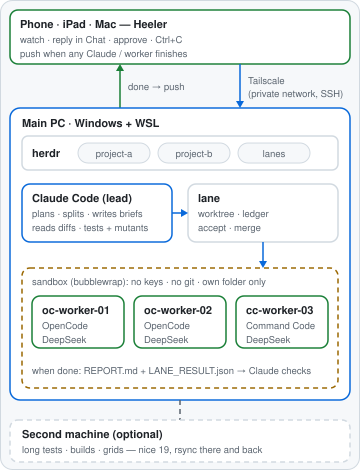

<p align="right"><b>English</b> · <a href="README.tr.md">Türkçe</a></p>

# agent-lanes

**Run AI coding agents in parallel lanes and verify their work before it merges.**

<picture>
  <source media="(prefers-color-scheme: dark)" srcset="docs/img/where-en-dark.svg">
  
</picture>

<sub>How we run it. The open-source tool in this repo is the <code>lane</code> box; the rest is our own setup around it (<a href="#our-setup">Our setup</a>).</sub>

You hand coding tasks to several cheap AI agents at once. Each one works in its own git worktree (a *lane*). When an agent says *"done, 33 tests pass"*, `agent-lanes` doesn't take its word for it:

1. it **reruns your tests** and compares the measured pass/fail counts with what the agent claimed,
2. it plants **deliberate bugs (mutants)** in the agent's code to prove its tests would catch them,
3. it only **merges** work that survives, and reverts the merge if the tests fail on `main`.

**Two ways in:**

- **Use the tool** → [The tool](#the-tool): the `lane` CLI in this repo. MIT, plain Python 3.12 standard library, no dependencies, 315 tests.
- **See how we run it** → [Our setup](#our-setup): Claude Code as the lead, sandboxed OpenCode / Command Code workers, herdr and Heeler on a phone, the hardware and what it cost. Not part of the tool.

## The tool

What this repo ships: the `lane` CLI (worktrees, a ledger, the result contract, `accept` with mutants, `merge`, a queue and remote hosts). What it does **not** ship: the agent wrappers and their sandbox, herdr, Heeler, or any model access. Those are yours to pick; [Our setup](#our-setup) shows ours.

### The loop

```
lane new oc-worker-01 --from main            # isolated worktree + branch, recorded in a ledger
lane run oc-worker-01 brief.txt              # agent works; must write .lane/LANE_RESULT.json + REPORT.md
lane review oc-worker-01                     # optional read-only AI review with a fixed checklist
lane mutants oc-worker-01                    # suggest mutants for the lines the agent changed
lane accept oc-worker-01 --test "python3 -m pytest -q" --mutants ~/agent-lanes/lanes/oc-worker-01/mutants.json
lane merge oc-worker-01 -m "add parser" --test "python3 -m pytest -q"
lane queue work.json --hosts local,gpu-box,laptop --max 3   # spread a queue over machines
lane gc                                      # dry run: which finished worktrees can go
lane hosts                                   # configured hosts, reachability, used/free capacity
lane host check gpu-box                      # ssh, rsync, worker, root, systemd
lane host setup gpu-box                      # install remote_runner.sh
lane stop oc-worker-01                       # stop a lane running on a remote host
```

Every command, flag and what it checks: [docs/cli.md](docs/cli.md).

### The result contract

Every brief gets this appended (`agent_lanes/contract.txt`). The agent must write:

```json
{"lane": "oc-worker-01", "status": "done",
 "summary": "Added CSV parser with header validation.",
 "files_changed": ["src/parser.py", "tests/test_parser.py"],
 "tests": [{"cmd": "python3 -m pytest -q", "passed": 12, "failed": 0}],
 "claims": [{"name": "rows/s", "value": 50000, "evidence": "bench.py"}],
 "blockers": []}
```

The reviewer reads 30 lines instead of a whole agent transcript. Every number in the file is then checked, not trusted.

### Install

```
git clone https://github.com/merterten/agent-lanes && cd agent-lanes
python3 -m unittest discover -s agent_lanes          # 315 tests, temp dirs only
ln -s "$PWD/agent_lanes/lane.py" ~/.local/bin/lane
```

Configuration is environment variables (`LANE_ROOT`, `LANE_MAIN_REPO`, `LANE_WORKTREES`, …); the full table is in [docs/cli.md](docs/cli.md#configuration).

The agent CLI is your own wrapper. It is called as `<bin> --write [-m MODEL] "<task>"` with the worktree as its working directory, and as `<bin> "<task>"` for read-only review/ask. Wrap any coding agent (OpenCode, Claude Code, Aider, …) behind that interface. **Run it in a sandbox:** the wrapper is where you keep the agent away from credentials and other folders. This repo deliberately doesn't ship one, because sandboxing depends on your machine.

### More machines

Spare PCs, laptops and GPU boxes can run lanes too: define them once in `~/.config/agent-lanes/hosts.toml`, then `lane run LANE --host NAME` or `lane queue work.json --hosts local,gpu-box,laptop --max 3`. Pushes and pulls go over rsync, every ssh call is non-interactive, and unreachable hosts get no new lanes. Setup, Windows/WSL notes and troubleshooting: [docs/multi-machine.md](docs/multi-machine.md).

### Safety rules the tool enforces

- Nothing in an agent's result file is ever executed. Test commands come from the reviewer.
- Stale results are moved aside before each run, so an old `LANE_RESULT.json` can never be accepted.
- `accept` fails when no test commands are given, and doesn't run mutants when the tests already fail (otherwise every mutant would look "killed").
- `merge` refuses unaccepted lanes, untested merges, a dirty `main`, and overlaps with other open lanes; it uses `revert`, never `reset --hard`.
- `gc` is a dry run by default and never removes a worktree with a running process inside, uncommitted changes, ignored data, or an open ledger status.

### How it was built

With its own workflow: DeepSeek agents wrote the modules in parallel lanes and Claude Code reviewed them; the review found real bugs their green tests had missed. [docs/how-this-was-built.md](docs/how-this-was-built.md)

## Our setup

Not part of the tool: this is how we run it day to day. Claude Code leads in one terminal workspace per project; cheap DeepSeek agents (OpenCode, Command Code) work in sandboxed lanes; [herdr](https://herdr.dev) keeps every session alive as a tab; Heeler on a phone shows them and pushes when one finishes. The diagram at the top is this setup.

| Where | Idea | What you get |
|---|---|---|
| Phone | Ping when a Claude finishes | Whichever workspace's Claude finishes, your phone gets a push; read it in Heeler's Chat view and reply there. |
| At the PC | Split the work | The lead Claude splits a task by file (say, into three); the workers run at the same time in separate sandboxes while you watch in herdr. |
| In the background | Overnight test runs | Workers run tests while you sleep; in the morning Heeler shows what failed and you hand it to the lead session. |
| Second machine | Offload heavy jobs | Long builds and test runs go to a second machine at `nice 19`; the main PC stays responsive and you watch from the phone. |
| Everywhere | Cheap model writes, Claude checks | Cheap DeepSeek workers write the code; Claude reads the diff and runs the tests itself. Cost goes down, quality does not. |

| Read more | |
|---|---|
| [docs/setup-guide.md](docs/setup-guide.md) | Roles, phone access, hardware and the example project's real cost |
| [docs/workers.md](docs/workers.md) | Our two worker wrappers: bubblewrap sandbox, key on a file descriptor, self-tests |
| [docs/remote-watching.md](docs/remote-watching.md) | Tailscale + herdr + Heeler: watching lanes from anywhere |
| [Full step-by-step guide (Turkish)](https://live.guytrades.workers.dev/r/D4mA5rcwHdBUheQajCHSTzTn) | From `wsl --install` to watching lanes on a phone, with ready-to-use Claude instructions ([CLAUDE.md](https://live.guytrades.workers.dev/r/D4mA5rcwHdBUheQajCHSTzTn/CLAUDE.md), [KURULUM.md](https://live.guytrades.workers.dev/r/D4mA5rcwHdBUheQajCHSTzTn/KURULUM.md)). There is no full English version yet. |

## License

MIT
