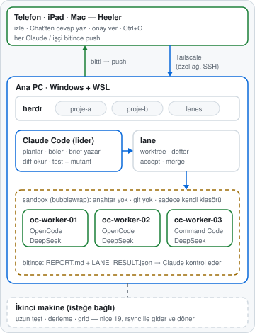

<p align="right"><a href="README.md">English</a> · <b>Türkçe</b></p>

# agent-lanes

**Yapay zekâ kod ajanlarını paralel lane'lerde çalıştır, işlerini birleştirmeden önce doğrula.**

<picture>
  <source media="(prefers-color-scheme: dark)" srcset="docs/img/where-tr-dark.svg">
  
</picture>

<sub>Bizim kullanım şeklimiz. Bu repodaki açık kaynak araç şemadaki <code>lane</code> kutusu; geri kalanı onun etrafındaki kendi kurulumumuz (<a href="#bizim-kurulumumuz">Bizim kurulumumuz</a>).</sub>

Kodlama işlerini aynı anda birkaç ucuz yapay zekâ ajanına verirsin. Her biri kendi git worktree'sinde (bir *lane*) çalışır. Bir ajan *"bitti, 33 test geçiyor"* dediğinde `agent-lanes` bu söze güvenmez:

1. **senin testlerini yeniden koşar** ve ölçülen geçen/kalan sayılarını ajanın iddiasıyla karşılaştırır,
2. ajanın koduna **bilerek hatalar (mutant)** yerleştirir; testlerin bunları yakaladığını kanıtlar,
3. sadece bunlardan sağ çıkan işi **birleştirir** (merge), `main` üzerinde testler düşerse birleştirmeyi geri alır.

**İki giriş yolu:**

- **Aracı kullan** → [Araç](#araç): bu repodaki `lane` CLI. MIT lisanslı, sadece Python 3.12 standart kütüphanesi, bağımlılık yok, 315 test.
- **Bizim nasıl kullandığımızı gör** → [Bizim kurulumumuz](#bizim-kurulumumuz): lider olarak Claude Code, sandbox içinde OpenCode / Command Code işçileri, telefonda herdr ve Heeler, donanım ve maliyet. Aracın parçası değil.

## Araç

Bu repoda olan: `lane` CLI (worktree'ler, bir defter, sonuç sözleşmesi, mutantlı `accept`, `merge`, bir kuyruk ve uzak makineler). Bu repoda **olmayan**: ajan sarmalayıcıları ve sandbox'ları, herdr, Heeler ya da herhangi bir model erişimi. Bunları sen seçersin; [Bizim kurulumumuz](#bizim-kurulumumuz) bizimkileri gösterir.

### Döngü

```
lane new oc-worker-01 --from main            # isolated worktree + branch, recorded in a ledger
lane run oc-worker-01 brief.txt              # agent works; must write .lane/LANE_RESULT.json + REPORT.md
lane review oc-worker-01                     # optional read-only AI review with a fixed checklist
lane mutants oc-worker-01                    # suggest mutants for the lines the agent changed
lane accept oc-worker-01 --test "python3 -m pytest -q" --mutants ~/agent-lanes/lanes/oc-worker-01/mutants.json
lane merge oc-worker-01 -m "add parser" --test "python3 -m pytest -q"
lane queue work.json --hosts local,gpu-box,laptop --max 3   # spread a queue over machines
lane gc                                      # dry run: which finished worktrees can go
lane hosts                                   # configured hosts, reachability, used/free capacity
lane host check gpu-box                      # ssh, rsync, worker, root, systemd
lane host setup gpu-box                      # install remote_runner.sh
lane stop oc-worker-01                       # stop a lane running on a remote host
```

Bütün komutlar, bayraklar ve neyi kontrol ettikleri: [docs/cli.md](docs/cli.md) (İngilizce).

### Sonuç sözleşmesi

Her brief'in sonuna bu eklenir (`agent_lanes/contract.txt`). Ajan şunu yazmak zorundadır:

```json
{"lane": "oc-worker-01", "status": "done",
 "summary": "Added CSV parser with header validation.",
 "files_changed": ["src/parser.py", "tests/test_parser.py"],
 "tests": [{"cmd": "python3 -m pytest -q", "passed": 12, "failed": 0}],
 "claims": [{"name": "rows/s", "value": 50000, "evidence": "bench.py"}],
 "blockers": []}
```

Gözden geçiren, ajanın bütün transkripti yerine 30 satır okur. Dosyadaki her sayı sonra kontrol edilir, güvenilmez.

### Kurulum

```
git clone https://github.com/merterten/agent-lanes && cd agent-lanes
python3 -m unittest discover -s agent_lanes          # 315 test, sadece geçici klasörler
ln -s "$PWD/agent_lanes/lane.py" ~/.local/bin/lane
```

Ayarlar ortam değişkenleriyle yapılır (`LANE_ROOT`, `LANE_MAIN_REPO`, `LANE_WORKTREES`, …); tam tablo [docs/cli.md](docs/cli.md#configuration) içinde (İngilizce).

Ajan komutu senin kendi sarmalayıcındır. Worktree çalışma klasörüyken `<bin> --write [-m MODEL] "<görev>"` olarak, salt okunur review/ask için de `<bin> "<görev>"` olarak çağrılır. Herhangi bir kod ajanını (OpenCode, Claude Code, Aider, …) bu arayüzün arkasına koyabilirsin. **Sandbox içinde çalıştır:** ajanı kimlik bilgilerinden ve diğer klasörlerden uzak tutacağın yer sarmalayıcıdır. Bu repo bilerek bir sandbox içermez, çünkü sandbox makineye göre değişir.

### Daha fazla makine

Boşta duran PC'ler, laptop'lar ve GPU makineleri de lane çalıştırabilir: her birini bir kez `~/.config/agent-lanes/hosts.toml` içinde tanımla, sonra `lane run LANE --host AD` ya da `lane queue work.json --hosts local,gpu-box,laptop --max 3`. Gidiş-dönüş rsync ile olur, her ssh çağrısı etkileşimsizdir, ulaşılamayan makineye yeni lane verilmez. Kurulum, Windows/WSL notları ve sorun giderme: [docs/multi-machine.md](docs/multi-machine.md) (İngilizce).

### Aracın zorladığı güvenlik kuralları

- Ajanın sonuç dosyasındaki hiçbir şey çalıştırılmaz. Test komutları gözden geçirenden gelir.
- Eski sonuçlar her çalıştırmadan önce kenara alınır; eski bir `LANE_RESULT.json` asla kabul edilmez.
- Test komutu verilmezse `accept` başarısız olur ve testler zaten düşüyorsa mutant koşmaz (yoksa her mutant "öldürülmüş" görünürdü).
- `merge`; kabul edilmemiş lane'leri, testsiz birleştirmeleri, kirli bir `main`'i ve açık lane'lerle çakışmaları reddeder; `reset --hard` değil `revert` kullanır.
- `gc` varsayılan olarak kuru çalışır ve içinde süreç çalışan, commit edilmemiş değişikliği, yok sayılan verisi ya da açık defter durumu olan bir worktree'yi asla silmez.

### Nasıl yapıldı

Kendi iş akışıyla: modülleri paralel lane'lerde DeepSeek ajanları yazdı, Claude Code gözden geçirdi; inceleme, ajanların yeşil testlerinin kaçırdığı gerçek hatalar buldu. [docs/how-this-was-built.md](docs/how-this-was-built.md) (İngilizce)

## Bizim kurulumumuz

Aracın parçası değil: biz onu her gün böyle kullanıyoruz. Claude Code her proje için ayrı bir terminal çalışma alanında liderlik eder; ucuz DeepSeek ajanları (OpenCode, Command Code) sandbox'lı lane'lerde çalışır; [herdr](https://herdr.dev) her oturumu bir sekme olarak canlı tutar; telefondaki Heeler onları gösterir ve biri bitince push atar. En üstteki şema bu kurulum.

| Nerede | Fikir | Ne kazanırsın |
|---|---|---|
| Telefon | Her Claude bitince haber | Hangi workspace'teki Claude cevabını bitirdiyse telefona push gelir; Heeler'ın Chat görünümünden okur, oradan cevap yazarsın. |
| PC başında | Paralel iş bölümü | Lider Claude görevi dosya bazında böler (örneğin üçe); işçiler ayrı sandbox'larda aynı anda çalışır, sen herdr'dan izlersin. |
| Arka planda | Gece test koşusu | Sen uyurken işçiler testleri koşar; sabah Heeler'da başarısız olanları görüp lider oturuma iletirsin. |
| İkinci makine | Ağır işleri devret | Uzun derleme ve test koşuları `nice 19` ile ikinci makineye gider; ana PC akıcı kalır, sonucu telefondan izlersin. |
| Her yerde | Ucuz model yazar, Claude kontrol eder | Kodu ucuz DeepSeek işçileri yazar; Claude diff'i okur, testleri kendisi koşar. Maliyet düşer, kalite düşmez. |

| Devamı | |
|---|---|
| [docs/setup-guide.tr.md](docs/setup-guide.tr.md) | Roller, telefondan erişim, donanım ve örnek projenin gerçek maliyeti |
| [docs/workers.md](docs/workers.md) (İngilizce) | İki işçi sarmalayıcımız: bubblewrap sandbox, dosya tanımlayıcısıyla anahtar, kendi kendine testler |
| [docs/remote-watching.md](docs/remote-watching.md) (İngilizce) | Tailscale + herdr + Heeler: lane'leri her yerden izlemek |
| [Adım adım tam rehber](https://live.guytrades.workers.dev/r/D4mA5rcwHdBUheQajCHSTzTn) | `wsl --install`'dan telefonda lane izlemeye kadar her adım, hazır Claude talimatlarıyla ([CLAUDE.md](https://live.guytrades.workers.dev/r/D4mA5rcwHdBUheQajCHSTzTn/CLAUDE.md), [KURULUM.md](https://live.guytrades.workers.dev/r/D4mA5rcwHdBUheQajCHSTzTn/KURULUM.md)). |

## Lisans

MIT
