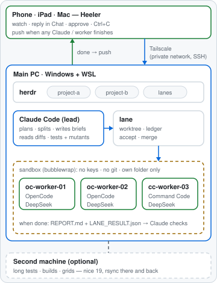

<b>English</b> · <a href="setup-guide.tr.md">Türkçe</a>

# Our setup: how we run agent-lanes

This page is **not part of the tool**. It is the setup around it that we use every day. The tool itself is described in the [README](../README.md#the-tool).

<picture>
  <source media="(prefers-color-scheme: dark)" srcset="img/where-en-dark.svg">
  
</picture>

## Where we use it

| Where | Idea | What you get |
|---|---|---|
| Phone | Ping when a Claude finishes | Whichever workspace's Claude finishes, your phone gets a push; read it in Heeler's Chat view and reply there. |
| At the PC | Split the work | The lead Claude splits a task by file (say, into three); the workers run at the same time in separate sandboxes while you watch in herdr. |
| In the background | Overnight test runs | Workers run tests while you sleep; in the morning Heeler shows what failed and you hand it to the lead session. |
| Second machine | Offload heavy jobs | Long builds and test runs go to a second machine at `nice 19`; the main PC stays responsive and you watch from the phone. |
| Everywhere | Cheap model writes, Claude checks | Cheap DeepSeek workers write the code; Claude reads the diff and runs the tests itself. Cost goes down, quality does not. |

## Roles

- **Lead: Claude Code.** Plans, splits work by file, writes the briefs, reads every diff, runs the tests itself, writes mutants, commits and merges. One session per project, each in its own herdr workspace.
- **Workers: OpenCode (default) and Command Code (fallback)** on DeepSeek V4.1 Flash, each in its own lane worktree inside a bubblewrap sandbox with no credentials and no git. See [workers.md](workers.md).
- **`lane`** sits between them: worktrees, the ledger, the result contract, `accept`, `merge`.

## Watching from a phone

We run lanes on two machines and watch them from a phone: Tailscale as the private network, herdr as the
terminal workspace server (one tab per lane worker), and Heeler as the phone client with a push when a lane
finishes. [remote-watching.md](remote-watching.md) collects the observations: closing sshd to the
tailnet, WSL jump hosts and linger, why remote lanes need `systemd --user`, keeping the herdr socket out of
worker sandboxes, and Heeler's exclusive live attach.

## Hardware in the loop

Everything below is on one private Tailscale network; nothing listens on the public internet.

| Machine | Hardware | Role in the loop |
|---|---|---|
| Desktop PC (Windows + WSL2) | AMD Ryzen 7 7800X3D (8 cores), 64 GB RAM, NVIDIA RTX 4090 24 GB, ~1.4 TB SSD | Lead session (Claude Code), local lanes in herdr, all git and merges. The 4090 runs GPU work locally: model inference, batch jobs, and video + audio generation |
| Laptop (Windows + WSL2) | Intel Core i7-13700H (14 cores / 20 threads), 32 GB RAM, integrated graphics | Always-on remote lane host: long CPU jobs as `systemd --user` units at `nice 19`, pushed and pulled with rsync; its own herdr `lanes` workspace |
| Mac mini (M2) | Apple M2 (8 cores), 16 GB RAM, 256 GB SSD | macOS host with its own herdr workspace for a separate project; reachable as an ssh host |
| Mac mini (M6) | Apple M6 (12 cores: 2 super, 4 performance, 6 efficiency), 16 GB RAM, 256 GB SSD | Second macOS host with herdr and the Heeler plugin; reachable as an ssh host |
| MacBook Pro (M4) | Apple M4 | Heeler client (Mac app) |
| iPhone / iPad | iOS / iPadOS | Heeler clients: watch lanes, get the push when one finishes, attach to a pane |

What each lane needs decides where it goes:

| Job | Where |
|---|---|
| Quick edit, review, anything touching git | Desktop, local lane |
| Long CPU grid / backtest / test matrix | Laptop (`--host laptop`, falls back to local) |
| GPU: inference, image / video / audio generation | Desktop (4090) |
| macOS-only build or check | Mac minis (M2, M6) |
| Watching, approving, nudging | Phone / tablet / MacBook Pro via Heeler |

## Example project: what it cost

[live.guytrades.workers.dev](https://live.guytrades.workers.dev) is a public page with eight demo-account forex and gold bots, built with this loop. Claude Code led and reviewed; Codex architected the first month; cheap DeepSeek agents ran the lanes; a local model on the 4090 did a private second review.

Counts are measured from the tools' own session logs (Claude Code and Codex transcripts, OpenCode's session databases, the local reviewer's job folders), deduplicated per API response, from the first session (2026-10-10) to 2026-11-23.

| Agent | Role | Tokens | Cost |
|---|---|---|---|
| Claude Code (Opus 5.5, plus a little Fable 5.2 and Haiku 5.5) | Lead coder and reviewer | 3.43 B, of which 3.38 B cache reads; 9.9 M output | **$1,198** at API list prices |
| Codex (GPT models) | Architect, then reviewer (Oct 10 – Oct 28) | 1.49 B, of which 1.43 B cached; 8.7 M output | subscription |
| OpenCode workers (DeepSeek Flash, some Pro) | ~420 lane runs (desktop + laptop) | 0.90 B, of which 0.87 B cache reads; 3.6 M output | **$12.58** |
| Command Code workers (mostly DeepSeek V4.1 Flash) | ~130 lanes, 41,562 requests (Nov) | 7.2 B | **$10** flat plan (99% of the monthly limit used) |
| Local RTX 4090 (Qwen 27B) | 25 private code reviews of safety fixes | 9.8 M | **2.5 GPU-hours**, about 1 kWh |

Strategy research and testing behind it:

| What | Count |
|---|---|
| Strategy studies (each with a brief, a pre-registered rule set or a written verdict) | 182 |
| Third-party strategies and indicators tested and rejected | 62 |
| Strategy configurations run forward on demo accounts | 21 (8 at a time) |
| Revisions to the bot's core code | 98 commits; at least 7 live packages deployed since 2026-11-13 |
| Automated tests | 1,246 in the bot's core suite, plus 102 Python test files for tools and dashboard |
| Price data tested on | 12 pinned datasets, 0.98 GB of packed binary: 6 years (2020–2026) of EURUSD and GBPJPY, 16 months of USDJPY ticks, USDJPY and gold minute bars, plus held-back periods kept out of design and opened only for the final check |

Every candidate had to pass on data it was not designed on, with costs included, before it got a demo account; most did not.

What this shows:

- **Cache reads are the bill.** 98% of Claude's tokens are re-read context. Long lead sessions are cheap per token and expensive in total.
- **The lanes were nearly free.** The workers burned more tokens than the lead (8.1 B vs 3.4 B) for about $23 in total: $12.58 on OpenCode and a $10 Command Code plan, roughly 2% of the lead's API-price cost. The expensive part is the lead reading diffs, writing mutants and reviewing.
- **The local GPU paid for itself in findings, not tokens.** It took about 6 minutes per review and found real integrity bugs that the green test suites had missed.

Notes: Claude and Codex ran on flat subscriptions, so their numbers are API-price equivalents, not cash spent. The Command Code figures come from its account dashboard for the November billing month (the plan started 2026-11-01). Claude Code deletes transcripts after 30 days, so Claude sessions before 2026-10-21 are missing and its number is a lower bound. Over the same period the project made 1,096 commits; its core test suite has 1,246 tests.

## Full step-by-step guide (Turkish)

[Sıfırdan kurulum](https://live.guytrades.workers.dev/r/D4mA5rcwHdBUheQajCHSTzTn): every step from `wsl --install` to watching lanes on a phone, with the worker wrappers and their self-tests, click-to-open intros for each tool, and ready-to-use Claude instructions ([CLAUDE.md](https://live.guytrades.workers.dev/r/D4mA5rcwHdBUheQajCHSTzTn/CLAUDE.md), [KURULUM.md](https://live.guytrades.workers.dev/r/D4mA5rcwHdBUheQajCHSTzTn/KURULUM.md)). There is no full English version yet.
