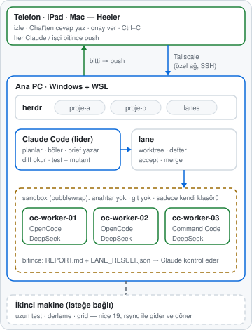

<a href="setup-guide.md">English</a> · <b>Türkçe</b>

# Bizim kurulumumuz: agent-lanes'i nasıl kullanıyoruz

Bu sayfa **aracın parçası değil**. Her gün kullandığımız, onun etrafındaki kurulum. Aracın kendisi [README](../README.tr.md#araç) içinde anlatılıyor.

<picture>
  <source media="(prefers-color-scheme: dark)" srcset="img/where-tr-dark.svg">
  
</picture>

## Nerede kullanıyoruz

| Nerede | Fikir | Ne kazanırsın |
|---|---|---|
| Telefon | Her Claude bitince haber | Hangi workspace'teki Claude cevabını bitirdiyse telefona push gelir; Heeler'ın Chat görünümünden okur, oradan cevap yazarsın. |
| PC başında | Paralel iş bölümü | Lider Claude görevi dosya bazında böler (örneğin üçe); işçiler ayrı sandbox'larda aynı anda çalışır, sen herdr'dan izlersin. |
| Arka planda | Gece test koşusu | Sen uyurken işçiler testleri koşar; sabah Heeler'da başarısız olanları görüp lider oturuma iletirsin. |
| İkinci makine | Ağır işleri devret | Uzun derleme ve test koşuları `nice 19` ile ikinci makineye gider; ana PC akıcı kalır, sonucu telefondan izlersin. |
| Her yerde | Ucuz model yazar, Claude kontrol eder | Kodu ucuz DeepSeek işçileri yazar; Claude diff'i okur, testleri kendisi koşar. Maliyet düşer, kalite düşmez. |

## Roller

- **Lider: Claude Code.** Planlar, işi dosya bazında böler, brief'leri yazar, her diff'i okur, testleri kendisi koşar, mutant yazar, commit ve merge yapar. Her proje için bir oturum, her biri kendi herdr workspace'inde.
- **İşçiler: OpenCode (varsayılan) ve Command Code (yedek)**, DeepSeek V4.1 Flash ile; her biri bubblewrap sandbox içinde, kendi lane worktree'sinde, kimlik bilgisi ve git erişimi olmadan. Bkz. [workers.md](workers.md) (İngilizce).
- **`lane`** ikisinin arasında durur: worktree'ler, defter, sonuç sözleşmesi, `accept`, `merge`.

## Telefondan izlemek

Lane'leri iki makinede çalıştırıp telefondan izliyoruz: özel ağ olarak Tailscale, terminal çalışma alanı sunucusu olarak herdr (her lane işçisine bir sekme), lane bitince push atan telefon istemcisi olarak Heeler. [remote-watching.md](remote-watching.md) (İngilizce) gözlemleri topluyor: sshd'yi tailnet'e kapatmak, WSL atlama makineleri ve linger, uzak lane'lerin neden `systemd --user` istediği, herdr soketini işçi sandbox'larının dışında tutmak ve Heeler'ın tekil canlı bağlantısı.

## Döngüdeki donanım

Aşağıdakilerin hepsi tek bir özel Tailscale ağında; hiçbiri genel internette dinlemiyor.

| Makine | Donanım | Döngüdeki rolü |
|---|---|---|
| Masaüstü PC (Windows + WSL2) | AMD Ryzen 7 7800X3D (8 çekirdek), 64 GB RAM, NVIDIA RTX 4090 24 GB, ~1,4 TB SSD | Lider oturum (Claude Code), herdr'da yerel lane'ler, bütün git ve merge işleri. 4090 GPU işlerini yerelde yapar: model çıkarımı, toplu işler, video + ses üretimi |
| Laptop (Windows + WSL2) | Intel Core i7-13700H (14 çekirdek / 20 iş parçacığı), 32 GB RAM, dahili grafik | Hep açık uzak lane makinesi: uzun CPU işleri `nice 19` ile `systemd --user` birimleri olarak, rsync ile gidip gelir; kendi herdr `lanes` workspace'i |
| Mac mini (M2) | Apple M2 (8 çekirdek), 16 GB RAM, 256 GB SSD | Ayrı bir proje için kendi herdr workspace'i olan macOS makinesi; ssh ile erişilir |
| Mac mini (M6) | Apple M6 (12 çekirdek: 2 süper, 4 performans, 6 verimlilik), 16 GB RAM, 256 GB SSD | herdr ve Heeler eklentisi olan ikinci macOS makinesi; ssh ile erişilir |
| MacBook Pro (M4) | Apple M4 | Heeler istemcisi (Mac uygulaması) |
| iPhone / iPad | iOS / iPadOS | Heeler istemcileri: lane'leri izle, biri bitince push al, bir pane'e bağlan |

Her lane'in neye ihtiyacı olduğu nereye gideceğini belirler:

| İş | Nerede |
|---|---|
| Hızlı düzenleme, inceleme, git'e dokunan her şey | Masaüstü, yerel lane |
| Uzun CPU grid'i / backtest / test matrisi | Laptop (`--host laptop`, ulaşılamazsa yerelde) |
| GPU: çıkarım, görüntü / video / ses üretimi | Masaüstü (4090) |
| Sadece macOS'ta yapılabilen derleme ya da kontrol | Mac mini'ler (M2, M6) |
| İzlemek, onaylamak, yönlendirmek | Heeler ile telefon / tablet / MacBook Pro |

## Örnek proje: maliyeti

[live.guytrades.workers.dev](https://live.guytrades.workers.dev), bu döngüyle yapılmış, sekiz demo hesap forex ve altın botunu gösteren herkese açık bir sayfa. Claude Code liderlik etti ve gözden geçirdi; ilk ay mimariyi Codex kurdu; lane'leri ucuz DeepSeek ajanları koştu; 4090'daki yerel bir model ikinci, özel bir inceleme yaptı.

Sayılar araçların kendi oturum kayıtlarından ölçüldü (Claude Code ve Codex transkriptleri, OpenCode'un oturum veritabanları, yerel inceleyicinin iş klasörleri), API cevabı başına tekilleştirildi; ilk oturumdan (2026-10-10) 2026-11-23'e kadar.

| Ajan | Rol | Token | Maliyet |
|---|---|---|---|
| Claude Code (Opus 5.5, biraz Fable 5.2 ve Haiku 5.5) | Lider kodlayıcı ve gözden geçiren | 3,43 milyar, bunun 3,38 milyarı önbellekten okuma; 9,9 milyon çıktı | API liste fiyatıyla **$1.198** |
| Codex (GPT modelleri) | Mimar, sonra gözden geçiren (10-28 Ekim) | 1,49 milyar, bunun 1,43 milyarı önbellekli; 8,7 milyon çıktı | abonelik |
| OpenCode işçileri (DeepSeek Flash, biraz Pro) | ~420 lane çalıştırması (masaüstü + laptop) | 0,90 milyar, bunun 0,87 milyarı önbellekten okuma; 3,6 milyon çıktı | **$12,58** |
| Command Code işçileri (çoğunlukla DeepSeek V4.1 Flash) | ~130 lane, 41.562 istek (Kasım) | 7,2 milyar | **$10** sabit plan (aylık limitin %99'u kullanıldı) |
| Yerel RTX 4090 (Qwen 27B) | Güvenlik düzeltmelerinin 25 özel kod incelemesi | 9,8 milyon | **2,5 GPU-saati**, yaklaşık 1 kWh |

Arkasındaki strateji araştırması ve testler:

| Ne | Sayı |
|---|---|
| Strateji çalışmaları (her birinin brief'i, önceden kayda geçmiş kural seti ya da yazılı kararı var) | 182 |
| Test edilip reddedilen üçüncü taraf strateji ve göstergeler | 62 |
| Demo hesaplarda ileriye doğru çalıştırılan strateji yapılandırmaları | 21 (aynı anda 8) |
| Botun çekirdek kodundaki revizyonlar | 98 commit; 2026-11-13'ten beri en az 7 canlı paket |
| Otomatik testler | Botun çekirdek takımında 1.246, artı araçlar ve panel için 102 Python test dosyası |
| Test edilen fiyat verisi | 12 sabitlenmiş veri seti, 0,98 GB paketli ikili: 6 yıllık (2020–2026) EURUSD ve GBPJPY, 16 aylık USDJPY tick'i, USDJPY ve altın dakika barları, artı tasarımdan uzak tutulup sadece son kontrolde açılan dönemler |

Her aday, demo hesap almadan önce, tasarlanmadığı veride ve maliyetler dahil geçmek zorundaydı; çoğu geçemedi.

Bunun gösterdiği:

- **Fatura önbellek okumaları.** Claude'un tokenlarının %98'i yeniden okunan bağlam. Uzun lider oturumları token başına ucuz, toplamda pahalı.
- **Lane'ler neredeyse bedavaydı.** İşçiler liderden fazla token yaktı (8,1 milyara karşı 3,4 milyar) ve toplam yaklaşık $23 tuttu: OpenCode'a $12,58 ve $10'lık Command Code planı; liderin API fiyatlı maliyetinin yaklaşık %2'si. Pahalı olan kısım liderin diff okuması, mutant yazması ve incelemesi.
- **Yerel GPU kendini tokenla değil bulgularla ödedi.** İnceleme başına yaklaşık 6 dakika sürdü ve yeşil test takımlarının kaçırdığı gerçek bütünlük hataları buldu.

Notlar: Claude ve Codex sabit aboneliklerle çalıştı, yani sayıları harcanan para değil API fiyatı karşılığı. Command Code sayıları Kasım fatura ayının hesap panelinden (plan 2026-11-01'de başladı). Claude Code transkriptleri 30 gün sonra siliyor, yani 2026-10-21 öncesi Claude oturumları eksik ve sayısı bir alt sınır. Aynı dönemde projede 1.096 commit yapıldı; çekirdek test takımında 1.246 test var.

## Adım adım tam rehber

[Sıfırdan kurulum](https://merterten.github.io/agent-lanes/kurulum/): `wsl --install`'dan telefonda lane izlemeye kadar her adım; işçi sarmalayıcıları ve kendi kendine testleri, her araç için tıklayınca açılan tanıtımlar ve hazır Claude talimatları ([CLAUDE.md](https://merterten.github.io/agent-lanes/kurulum/CLAUDE.md), [KURULUM.md](https://merterten.github.io/agent-lanes/kurulum/KURULUM.md)).
